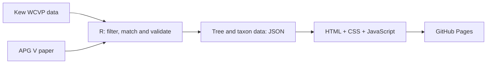

# Baltic phylogeny website workflow

The project has two main parts: **R prepares the scientific data and tree structure; the webpage’s HTML, CSS, and JavaScript make that structure interactive.** GitHub Pages serves the finished files.



**1. Getting the Baltic plant data**

We started with `expowo`, studying its documentation and inspecting its installed functions. That established the geographic limitation: Lithuania belongs to the botanical region **Baltic States, BLT**, which also includes Latvia, Estonia, and the Karaliaučius region.

Live POWO requests encountered Cloudflare security challenges, so the completed extraction used **Kew’s official WCVP version 16 download**. That distinction matters: our records are a dated WCVP snapshot, rather than a live scrape of every POWO page.

The main processing script, [POWO.R](../POWO.R), does the following:

- Reads the name and distribution files.
- Selects distribution records belonging to `BLT`.
- Matches them to taxonomic records using identifiers.
- Adds the necessary parent genera and derived family records.
- Retains names, authorship, identifiers, original distributions, statuses, and provenance.
- Saves local CSV/RDS files and generates the SQL import.

The resulting table contains **4,502 rows**. The database retains the broader dataset, including infraspecific and unplaced records. The website applies the narrower filters you requested.

**2. The R packages used**

| Package | Its role in this project |
|---|---|
| `expowo` | Supplied family codes and the botanical-region/country correspondence; its functions were also inspected during the initial investigation. |
| `data.table` | Read and processed the large WCVP files efficiently, matched records, and produced exports. |
| `httr` | Downloaded the official archive. |
| `jsonlite` | Created JSON for nested database fields and the webpage’s tree, lists, and metadata. |
| `digest` | Calculated SHA-256 checksums to identify the source files precisely. |
| `pdftools` | Extracted text and word positions from the APG V PDF. |
| `ape` | Read and validated the Newick tree, created the R `phylo` object, and drew the full-size static tree. |

Base R also handles much of the work: filtering, recursive functions, saving workspaces, and writing files. Its `graphics` and `grDevices` packages provide the plotting and SVG output.

The actual database import runs through **Docker and PostgreSQL’s `psql`**, using the SQL generated by R.

**3. Turning the APG V paper into our tree**

The scientific construction is in [build_baltic_phylogeny.R](../scripts/build_baltic_phylogeny.R).

There were two different tasks here.

First, I **manually transcribed the order relationships in Figure 1** into nested R lists. A node contains its name, its kind—clade, order, or family—and its children.

For example, a small part of the structure conceptually looks like:

```text
Order
├── Family
├── Family
└── Family
```

Second, I used `pdftools` to extract the family classification from Appendix B. Because the PDF has two columns, the script uses word coordinates to reconstruct the reading order. It then checks that all **407 numbered families** were recovered.

The builder matches our Baltic families to that classification and removes orders without Baltic representatives.

This produces:

- **103 flowering-family tips in 36 orders**.
- A mapping from the **104 original flowering-family names** to those tips.
- A separate panel for the **13 non-flowering families**.

The reduction from 104 names to 103 tips comes from APG V including **Phrymaceae within Orobanchaceae**. Both original families remain identifiable in our data, and their lists are combined for that tip.

The solid branches reproduce the paper’s order relationships. The dashed family branches express membership within an order. We did not infer additional family relationships, evolutionary dates, or genetic distances.

**4. How R generates the webpage**

The builder writes `phylogeny_data.json`. This contains the tree, family counts, taxon lists, POWO links, and provenance.

Within a family, the data are arranged like this:

```text
Family
└── Genera
    ├── Genus name, ID and POWO link
    └── Species
        └── Species name, ID and POWO link
```

Species are attached to genera using **WCVP parent identifiers**. That avoids guessing the relationship from the first word of a name, and preserves hybrid-genus identities.

The species filter is explicitly:

```r
taxon_rank == "Species" & taxon_status == "Accepted"
```

Consequently, the website lists exclude subspecies, varieties, forms, and unplaced names. Accepted hybrids remain included, consistently with the displayed counts.

R then reads [the HTML template](../templates/baltic_phylogeny.html) and inserts the JSON at a designated marker. The finished HTML contains:

- The page structure.
- Its styling.
- The interaction code.
- All the data required to explore the tree and lists.

That is why the downloaded HTML works offline. Opening a POWO link is the point at which an internet connection is needed.

**5. How the tree expands and collapses**

The interactive tree is drawn using **SVG**, which represents branches, circles, and labels as individual browser elements.

The JavaScript assigns each node an identifier and maintains a set called `collapsed`. Initially, the order nodes are in that set.

When you click an internal node:

1. Its identifier is added to or removed from `collapsed`.
2. The layout function walks through the currently visible branches.
3. It calculates new positions.
4. The SVG is redrawn.

Collapsing a branch hides its descendants; their data remain available.

For positioning, visible terminal nodes receive evenly spaced vertical positions. Parent nodes sit between their visible children. Horizontal positions separate the backbone, orders, and families. The branches are drawn as horizontal and vertical SVG paths.

Selecting a family also opens its ancestors, highlights its path through the tree, updates the information panel, and moves the view towards that family.

**6. How zooming and panning work**

The tree sits inside one SVG group. Moving and zooming change that group’s transformation:

```javascript
translate(tx, ty) scale(scale)
```

Here, `tx` and `ty` control position, while `scale` controls magnification.

Mouse-wheel events, touch gestures, dragging, and the zoom buttons update those values. The underlying relationships stay unchanged.

The labels receive special treatment: their font size is adjusted against the zoom level to keep them readable. At very low zoom, some labels are temporarily hidden to reduce overlap.

**7. How the genus and species expanders work**

Those count rows use the browser’s native disclosure elements:

```html
<details>
  <summary>Accepted Baltic species …</summary>
  <!-- Search field and species list -->
</details>
```

The browser supplies the basic opening, closing, and keyboard behaviour. JavaScript adds the remaining behaviour:

- Opening one list closes the other.
- List contents are generated when first opened.
- Typing filters the family’s embedded data immediately.
- Species results are grouped under their genera.
- Names are ordinary hyperlinks carrying the original POWO URLs.

There is no database query or R calculation when somebody clicks a count or searches a list. Those interactions happen entirely in their browser.

Long lists have a bounded scrolling area, keeping a large family such as Asteraceae from making the information panel excessively long.

**8. Keeping the mobile layout tidy**

The styling uses CSS Grid for the main layout. On wide screens, the tree and information panel occupy separate columns. Below the responsive breakpoint, the panel moves underneath the tree.

Other details help on phones:

- Buttons wrap when space is limited.
- List links have larger touch targets.
- Search inputs use 16-pixel text to avoid unwanted focus zoom on iPhones.
- Long names can wrap.
- List height adapts to the available screen height.
- Light and dark colours follow the device’s preference.

During testing, I discovered that Chrome’s Windows window-size setting could produce a wider viewport than requested. I changed the test script to set the **actual browser viewport** through Chrome’s debugging protocol.

The final live-page checks passed at **380, 500, 900, and 1,440 pixels**. Those checks cover the existing tree controls as well as list counts, links, grouping, search, empty results, and overflow. I also inspected open-list screenshots in both themes.

**9. Publishing and saving**

The publishing script copies an explicit selection of finished files into `publish/github-pages/`, where the main HTML becomes `index.html`.

That folder is its own Git repository. We commit changes and push to GitHub; GitHub Pages publishes the `main` branch. The R workspaces, database backups, bulk source files, and original articles remain in the local analysis project.

Finally, the project’s `.Rprofile` loads the workspace-saving helper. It restores missing R objects from `POWO_latest.RData`, saves on normal exit, and makes checkpoints after completed commands when enough time has elapsed.

So there are three useful things you can continue working with independently: **the full database, the reproducible R analysis, and the self-contained interactive website.**
